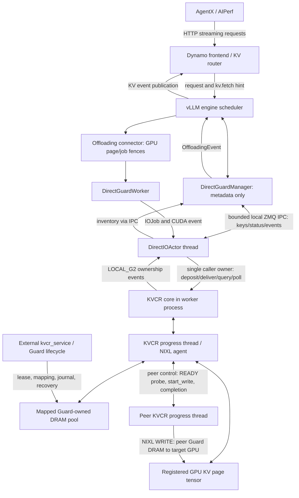
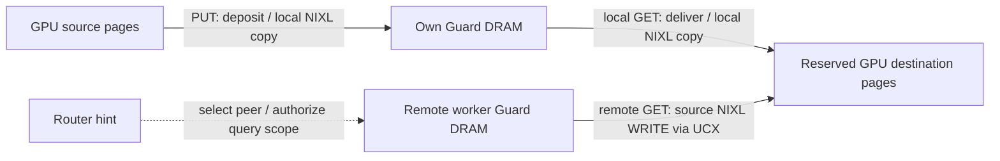

# Direct Guard r18: in-tree architecture and implementation design

This document describes the **implemented r18 system**, rather than a proposed replacement. It is grounded in the sealed r18 sources, configuration and measured run. The original benchmark archive is `kvcr-directguard-agentx/attempts/runtime-r18/`; its run artifacts are not included in this repository. Proposed improvements are separated in §12. It is intended for developers implementing, reviewing or reproducing this integration.

## In-tree packaging update

The adapter now lives at `vllm/distributed/kv_transfer/kv_connector/v1/kvcr/guard_direct/`,
mirroring `mooncake/store`. `KVCRDirectGuardConnector` and `KVCRDirectGuardSpec` are
registered lazily in their respective factories. No adapter `PYTHONPATH` or custom
module-path fields are required. The external KVCR library remains a separate
native dependency; scheduler, I/O actor, GPU fences and READY-subset semantics
are unchanged.

CPU tests live in `tests/v1/kv_connector/unit/kvcr_guard_direct/`, with a weight-free
geometry smoke in `tests/v1/kv_connector/kvcr_integration/`. The [README](../../examples/kv_offloading/guard_direct/README.md) and
[sample configuration](../../examples/kv_offloading/guard_direct/kv-transfer.json)
are included on this documentation branch. Source links point to the in-tree
package or the pinned KVCR implementation. Historical run receipts and scripts
remain plain benchmark-archive paths for provenance.

## 1. Scope, goals and revision identity

The system integrates KVCR-owned DRAM with vLLM GPU KV pages, preserving Dynamo hint-based routing and KVCR's independent memory ownership. Its three payload paths are:

1. GPU → the worker's own Guard DRAM, using `deposit()`.
2. Own Guard DRAM → GPU, using `deliver()`.
3. Hinted remote Guard DRAM → the requesting worker's GPU, using `deliver()` and a source-side NIXL WRITE.

There is no framework CPU payload cache, target-side Guard relay, centralized block-location server, or source-side vLLM pin callback in this mode. The framework still schedules requests, reserves GPU pages and consumes completions. “Direct” describes the registered payload endpoints; it does not assert that every selected UCX protocol has no internal staging.

**r18 versus r17:** the direct adapter and KVCR data path are unchanged. R18 changes Dynamo from hard session affinity / decode-load weight 0 to soft affinity / weight 64. R19 repeats the same r18 experiment configuration and source archive. The earlier hint-driven host-cache adapter and the direct adapter described here are different implementations.

| Identity | Pinned value / authoritative evidence |
| --- | --- |
| KVCR official base | `34bb11986e096e249c76186cd60e28091f2fcb2e` |
| Customized KVCR archive SHA-256 | `1485c53f6645b6096f68f4bf228b9313a6f24c3f9e8aaacf2a134ad13e37d3f4` |
| Adapter | [`software/adapter/kvcr_direct`](../../vllm/distributed/kv_transfer/kv_connector/v1/kvcr/guard_direct), copied into the sealed bundle |
| Exact source/package hashes | `kvcr-directguard-agentx/attempts/runtime-r18/config/harness-overlays.json`, `kvcr-directguard-agentx/attempts/runtime-r18/config/core-validation.json`, `kvcr-directguard-agentx/attempts/runtime-r18/config/adapter-validation.json` |
| Serving image, Dynamo wheels and baseline overlays | `kvcr-directguard-agentx/attempts/runtime-r18/bundle/config/sources.json`, `kvcr-directguard-agentx/attempts/runtime-r18/config/baseline-manifest.json` |
| Run | `kvcr-directguard-agentx-20261024-r18` |
| Experiment | `kvcr-directguard-agentx/attempts/runtime-r18/config/experiment.json` |
| Result and limitations | `kvcr-directguard-agentx/attempts/runtime-r18/runs/kvcr-directguard-agentx-20261024-r18/final-report.md` |

The source archive and package hashes are essential: checking out the official base commit alone does not reproduce the READY-query, export-claim and capture implementation used here.

## 2. System architecture and ownership



The diagram shows one engine; r18 has eight DP engines, one GPU and one independently owned Guard pool per engine. TP=1 and expert parallelism are enabled in the serving deployment.

**Guard ownership is not execution placement.** The external service owns the durable pool and lease/recovery machinery. While a worker is alive, its KVCR core maps the leased pool and its KVCR progress thread serves native transfers. The remote source fast path runs on that progress thread, which is inside the source worker process; it does not require that worker's vLLM execution thread or caller-side metadata polling to obtain an export reader. On failure, the existing Guard takeover/recovery machinery manages handover. This benchmark does not establish a measured failover SLO.

| Component | Responsibility | Does not own |
| --- | --- | --- |
| Dynamo | Routing, session preference, decode-load cost, KV hints | Physical block residency or transfer completion |
| vLLM scheduler / connector | Prefix decisions, physical GPU page reservations, scheduling after completion, recomputation | Guard allocator |
| `DirectGuardManager` | Bounded asynchronous lookup state, hint scope, inventory and metrics forwarding | CPU KV bytes or a remote residency lease |
| `DirectGuardWorker` | Validate key→GPU-page mapping, record CUDA dependencies, retain GPU lifetime | Source-side framework pinning |
| `DirectIOActor` | Sole owner of the caller-facing KVCR API; job admission and completion | Native transport progress |
| KVCR core / local DRAM | Residency state, admission, policy, publication, joined per-key results | vLLM tensor allocation |
| KVCR progress / remote backend | Peer protocol, metadata exchange, export claims, NIXL progress and cleanup | Scheduling attention kernels |
| Guard service | Pool creation, exclusive lease, mapping/journal lifetime and takeover | Normal vLLM request scheduling |

The local scheduler↔actor IPC is not a centralized metadata server. Each engine owns its own channel and local metadata; cross-worker discovery uses router hints and peer confirmation.

## 3. Memory model, keys and compatibility

### 3.1 GPU registration and Guard pools

[`PackedLayout`](../../vllm/distributed/kv_transfer/kv_connector/v1/kvcr/guard_direct/layout.py) certifies a narrow layout: one CUDA byte tensor, two dimensions, one complete packed page per physical block, unit inner stride, and `blocks_per_chunk=1`. Every KV group must reference that packed page representation. The adapter rejects unsupported layouts rather than assuming that arbitrary layer tensors are contiguous.

The GPU region is registered as:

```python
RegionDescriptor(
    mem_type="VRAM", device_Id=device_index,
    addr=tensor.data_ptr(), stride=tensor.stride(0),
    size=page_bytes, count=num_physical_pages, label="",
)
# A job selects pages; it never passes an unregistered raw pointer.
MemoryRef(end_point_name=agent_name, label="", element_index=physical_gpu_id)
```

Physical page 0 is vLLM's null page and cannot be a transfer endpoint. Keys and GPU indices must be unique/matched in cardinality, within bounds, and ordered by the original KV group list. Key suffixes encode the group ID as four big-endian bytes. A Guard slot index is independent of a GPU physical page ID.

Each Guard requests **124 GiB = 133,143,986,176 bytes**, chunk-rounded by the actual page geometry. Eight pools request **992 GiB** of payload DRAM. Framework host-cache payload is **0 bytes**. Journal, pool metadata, model loading, Python/native state and other runtime allocations are additional. The harness budgets 100 MiB journal per rank and checks at least 768 GiB additional startup headroom; the budget is not a claim that the process consumes exactly 992 GiB total RAM.

The pool is service-owned shared storage mapped into the active core. Pool leases, residency claims, export readers and GPU reservations have separate lifetimes; none substitutes for another. Mapping attachment verifies the backing identity/geometry and the lifetime lock. Do not instantiate another independent allocator over an actively leased pool.

### 3.2 Block identity and hint geometry

[`router_geometry.py`](../../vllm/distributed/kv_transfer/kv_connector/v1/kvcr/guard_direct/router_geometry.py) validates the installed vLLM/Dynamo cache-group resolver and a canonical router block size of **256 tokens**. Group token spans must fit this geometry and the request hash unit. The compatibility digest is `dsv4-dspark-fp8-mxfp4-bs256-direct-guard-v1`; it is a deployment contract, not a replacement for runtime layout validation. A different model, quantization, sharding or packed-page format requires reevaluating the digest and tests.

Dynamo's canonical block hashes do not automatically cover every hybrid KV group. [`HintScope`](../../vllm/distributed/kv_transfer/kv_connector/v1/kvcr/guard_direct/hint_scope.py) uses scheduler-supplied key positions to authorize group chunks contained within explicitly hinted canonical parents. It requires an actual canonical parent hash at that position and fails closed on contradictory positions. It does not authorize arbitrary unhinted prefixes. This preserves group membership while permitting valid shorter group chunks.

### 3.3 Residency and export safety

```mermaid
stateDiagram-v2
    [*] --> FILLING: reserve slots / start deposit
    FILLING --> READY: successful committed pieces / complete layout
    FILLING --> DISCARDING: failed or canceled fill
    READY --> READY: export claim increments readers / release decrements
    READY --> DISCARDING: retire or evict; withdraw export
    DISCARDING --> [*]: writers and claims/readers safely drained; free slots
```



This is a conceptual view over `_LocalDramState` and its counters. `pending_labels`, writers, `claim_count`, `retire_on_release` and `export_readers` determine the exact legal transitions. An allocated slot is not necessarily READY or exportable.

[`_publish_export()` and `claim_export_subset()`](https://github.com/ai-dynamo/kvcr/blob/0cc2cc94b987cadce6c65eb000b61f425ab1ee7a/src/kvcr/local_dram.py) maintain immutable export references under a short `_export_lock`. Claims increment independent export readers. Eviction withdraws exports and rechecks reader eligibility before reuse; retired data remains physically protected while existing readers drain. Caller operations take `_state_lock` before `_export_lock` where both are needed. The remote fast path takes the export lock without acquiring caller `_state_lock` or invoking framework policy.

## 4. Key API interfaces

These signatures summarize the implemented boundary; argument/result definitions remain authoritative in the linked files.

| Layer | Interface | Contract |
| --- | --- | --- |
| vLLM factory | `KVCRDirectGuardSpec.get_manager()` / `get_worker(kv_caches)` | Construct metadata manager and direct worker, without a CPU tier manager |
| Scheduler | `lookup(key, req_context)` | `HIT`, `MISS`, or `RETRY`; unresolved metadata is asynchronous |
| Scheduler | `prepare_load(keys, req_context)` | `DirectSpec(keys, request_id, hint)` after local/hint-scope validation |
| Scheduler | `prepare_store(keys, req_context)` | Store spec without allocating CPU chunks |
| GPU worker | `submit_store(job_id, src_spec, dst_spec)` / `submit_load(...)` | Map physical GPU pages, record CUDA event, enqueue `IOJob` |
| GPU worker | `get_finished()` / `wait(job_ids)` | Only return safely releasable jobs; wait preserves GPU reuse fences |
| KVCR | `submit_hint(hints, request_id)` | Install request-scoped routing advice |
| KVCR | `query_ready(keys, request_id, timeout_ms=5000)` | Nonblocking local/remote confirmed READY observation; not a lease |
| KVCR | `query_ready_observations(keys, request_id)` | Target-clock expiry and source identity for status caching |
| KVCR | `deposit(blocks, no_evict=False, hints=None, expected_layout=None)` | Async copy into own managed DRAM; adapter supplies `expected_layout=[""]` |
| KVCR | `deliver(blocks, request_id=None)` | Async direct delivery into supplied registered destinations |
| KVCR | `poll_completed()` | Per-operation, per-key results; native hazards can outlive a logical failure |
| KVCR lifetime | `close()`, resilience callbacks | Quiesce native work before releasing mappings/tensors |

Sources: [`spec.py`](../../vllm/distributed/kv_transfer/kv_connector/v1/kvcr/guard_direct/spec.py), [`manager.py`](../../vllm/distributed/kv_transfer/kv_connector/v1/kvcr/guard_direct/manager.py), [`worker.py`](../../vllm/distributed/kv_transfer/kv_connector/v1/kvcr/guard_direct/worker.py), [`api.py`](https://github.com/ai-dynamo/kvcr/blob/0cc2cc94b987cadce6c65eb000b61f425ab1ee7a/src/kvcr/api.py), [`types.py`](https://github.com/ai-dynamo/kvcr/blob/0cc2cc94b987cadce6c65eb000b61f425ab1ee7a/src/kvcr/types.py).

`fetch()` is deliberately unused by the adapter: it materializes KVCR-managed target storage. `deliver()` supplies GPU destinations and remote `local_fill=False`, so a remote GET needs no target Guard staging allocation. The implemented `deliver()` has **no** `expected_layout` keyword; do not copy a proposed API extension from older research notes into r18 reproduction code.

The scheduler metadata protocol is MessagePack over a local ZMQ DEALER/ROUTER channel. Requests are `query`, `hint`, `finish`, `touch`, and `poll`; every request is acknowledged. Replies carry statuses, validity observations, inventory events, metric rows or explicit errors. No KV payload crosses this channel. [`protocol.py`](../../vllm/distributed/kv_transfer/kv_connector/v1/kvcr/guard_direct/protocol.py)

## 5. Control path: lookup, publication and routing

```mermaid
sequenceDiagram
    participant R as Dynamo router
    participant S as vLLM scheduler / manager
    participant A as DirectIOActor
    participant T as Target KVCR progress
    participant P as Source KVCR progress
    participant E as Source export table
    R->>S: request + kv.fetch(source endpoint, canonical hashes)
    S->>S: validate key positions and hint scope
    S->>A: hint + query(keys), nonblocking IPC
    A->>T: submit_hint; query_ready
    T->>P: ready_probe with layout / request generation
    P->>E: probe_export_subset (no reader claim)
    E-->>P: READY bitmap / generations / export sequence, or busy
    P-->>T: identity-bound ready_probe_reply
    T-->>A: FETCHABLE / FETCHING / MISS + validity
    A-->>S: metadata reply
    S->>S: schedule load, defer pending lookup, or compute miss
    Note over S,E: Positive READY is a snapshot. GET must claim again.
```

Local ready inventory can satisfy the eligibility gate; absent local inventory and no hint, the manager returns MISS without a pointless remote query. Remote `FETCHABLE` requires source confirmation in [`ready_query.py`](https://github.com/ai-dynamo/kvcr/blob/0cc2cc94b987cadce6c65eb000b61f425ab1ee7a/src/kvcr/ready_query.py). `FETCHING` remains transient. Reply validation checks request/probe identity, peer incarnation/route state, layout and target-clock validity. Stale or incompatible observations cannot grant residency.

Manager bounds in r18 include 4,096 requests by default, **524,288 live keys per request**, 32,768 keys per metadata query, 1,024 pending IPC requests and a default status TTL of 5 seconds. Positive/transient observations expire. Confirmed MISS decisions persist for that request so that large prefixes converge instead of restarting queries as unrelated keys resolve. Changed hint authorization/source identity invalidates affected decisions; request finish drops request state. These bounds should be considered when changing context length.

After successful Guard admission, KVCR emits LOCAL_G2 inventory. The actor forwards it to the manager, which creates `OffloadingEvent(..., medium=CPU, ownership="kvcr", removal_expected=True)`. The pinned vLLM event path publishes these events to Dynamo; removals invalidate metadata. The CPU medium identifies DRAM and does not mean a framework CPU cache exists.

Dynamo discovers the custom connector's hint endpoint through `secondary_tiers` capability metadata. **Keep that entry even though there is no secondary-tier manager.** Startup verifies the installed wheel's endpoint/capability helpers and proves that removing the entry disables discovery. Router events are advice; transfer-time claims remain authoritative.

R18 frontend policy is:

```text
--router-mode kv
--router-session-affinity-ttl-secs 3600
--router-session-affinity-mode soft
--router-decode-active-request-weight 64
```

Soft affinity permits moving a session when load favors another engine; the decode weight adds block-equivalent cost per active decode request. Neither setting disables KV hints. A less overloaded engine can improve TTFT even if it incurs more cache lookup/transfer work.

## 6. Data paths and core operation sequences



The source and destination descriptor lists are resolved from registered regions. GPU↔Guard copies and remote writes use NIXL; Python control logic does not copy payload bytes. Source DRAM slots and destination GPU IDs may be noncontiguous; prepared descriptor selection preserves their mapping.

### 6.1 PUT: GPU → own Guard

```mermaid
sequenceDiagram
    participant V as vLLM connector / GPU stream
    participant A as DirectIOActor
    participant K as KVCR caller / local DRAM
    participant P as KVCR progress / NIXL
    participant R as Inventory / router
    V->>V: retain source GPU pages; record producer CUDA event
    V->>A: enqueue store IOJob(keys -> physical pages)
    A->>A: event.query() succeeds
    A->>K: deposit(VRAM refs, expected_layout=[empty label])
    K->>K: reserve Guard slots; mark FILLING
    K->>P: schedule GPU -> Guard copy
    P->>P: native transfer DONE and handle cleanup
    P-->>K: completed local copy
    A->>K: poll_completed(): process owner-side commit
    K->>K: committed layout READY; publish export
    K-->>R: LOCAL_G2 inventory event
    K-->>A: per-key result
    A-->>V: safe job completion; source pages can be reused
```

Successful API PUT bytes are not necessarily DMA bytes: a key already resident can complete without another native copy. Publication requires committed READY data. The caller/actor still processes fill completion and publication; the design removes source-side GET pin waiting, not all owner-side PUT work.

### 6.2 Local GET: own Guard → GPU

1. Scheduler identifies eligible cached keys and prepares a load spec.
2. vLLM reserves destination GPU pages; the worker validates group order and records a CUDA event.
3. Actor waits for the dependency and calls `deliver({key: [GPU ref]}, request_id)`.
4. Core separates local and remote keys; local DRAM protects the source and schedules NIXL copy into the registered GPU destination.
5. Actor polls per-key completion, preserves any GPU hazards, establishes GPU visibility, then returns the result.
6. Connector marks the job completed; vLLM can schedule the consuming model work. Failed destinations take the recomputation path.

See [`_KVCRCore.deliver`](https://github.com/ai-dynamo/kvcr/blob/0cc2cc94b987cadce6c65eb000b61f425ab1ee7a/src/kvcr/core.py), [`_LocalDram.deliver`](https://github.com/ai-dynamo/kvcr/blob/0cc2cc94b987cadce6c65eb000b61f425ab1ee7a/src/kvcr/local_dram.py) and `DirectIOActor._poll()`.

### 6.3 Remote GET: hinted Guard → target GPU

```mermaid
sequenceDiagram
    participant V as Target vLLM / GPU fences
    participant A as Target DirectIOActor
    participant T as Target KVCR progress
    participant P as Source KVCR progress
    participant E as Source Guard export table
    participant N as NIXL / UCX
    V->>A: load IOJob + destination GPU pages + CUDA event
    A->>A: dependency complete; submit request hint
    A->>T: deliver(GPU refs); local_fill=False
    T->>P: start_write(keys, GPU refs, route/incarnation)
    P->>E: claim_export_subset (nonblocking lock)
    E-->>P: READY subset + independent export readers
    Note over P,E: No source caller handoff, vLLM callback, or framework pin-wait
    P->>P: validate selected GPU refs / route generation
    P->>N: WRITE selected Guard DRAM -> target GPU
    N-->>P: DONE; native lifecycle cleanup
    P->>E: release source export readers when safe
    P-->>T: write_done + original completed_indices
    T->>T: map successes / missing keys; complete target API
    T-->>A: per-key results / hazard state
    A->>A: native hazards cleared; GPU visibility step
    A-->>V: safely releasable result / invalid destination IDs
    V->>V: consume successful load or recompute failed request
```

Connection/agent metadata exchange is omitted from the diagram for clarity and may precede `start_write`; it remains real control cost. `_start_target_pull()` uses direct GPU destinations, and `_handle_start_write()` selects `_start_guard_source_write()` when Guard-only mode is active. That function claims only compatible published data, validates **selected** destinations, and constructs `_SourceWriteOp` with aligned source/destination subsets and original indices. Empty/busy selection returns explicit missing data rather than invoking `_SourcePinOp`.

The target state enum is `START_WRITE → WAITING_WRITE_DONE → WAITING_TERMINAL → FINISHED`, with `QUARANTINED` for unresolved native ownership. The source enum includes `READY_TO_WRITE`, `WRITING`, `NOTIFY_FAILURE`, `CANCEL_PENDING`, and `FINISHED`; error/cancel branches do not form a single unconditional linear chain. See [`remote_fw_dram.py`](https://github.com/ai-dynamo/kvcr/blob/0cc2cc94b987cadce6c65eb000b61f425ab1ee7a/src/kvcr/remote_fw_dram.py).

Illustrative pseudocode preserving the implementation's boundaries:

```python
# Target actor: only this thread calls the public KVCR API.
if job.ready_event.query():
    refs = gpu_refs(job.mapping, next_bounded_keys(job))
    handle = kvcr.deposit(refs, expected_layout=[""]) if job.is_put else kvcr.deliver(refs, job.request_id)
    track_handle_and_per_key_ownership(handle, job)

# Source progress: does not ask the source framework to provide missing data.
selected, busy = local_dram.claim_export_subset(keys, requested_labels, key_layout)
validate_selected_destinations_and_current_route(selected)
if selected:
    submit_nixl_write(guard_refs(selected), target_gpu_refs(selected))
else:
    send_explicit_empty_subset_completion()
# Native failure/timeout still retains readers until transport is quiescent.
finish_native_lifecycle_then_release_export_readers()
send_original_completed_indices_to_target()

# Target actor: a failed logical result alone is not a GPU reuse fence.
for handle, entries in kvcr.poll_completed():
    account_per_key_results(handle, entries)
if all_keys_terminal(job) and no_live_native_batches(job) and not hazards.blocks(job.gpu_ids):
    if job.is_get:
        gpu_visibility.complete_reads()
    return_safe_result_to_vllm(job)
```

## 7. Concurrency, admission and GPU safety

The worker wrapper records the CUDA event on the current device stream, then enqueues the job. The actor sets the CUDA device and owns the KVCR caller API. KVCR's separate progress thread owns native initialization, communication and progress. Cross-thread scheduler metadata uses IPC; payload-job submission uses an in-process bounded queue.

R18 actor scheduling has an incoming queue of 256 jobs, ingests at most 16 per iteration, and permits at most **16 outstanding KVCR API handles**. The default payload batch is **256 keys per API operation**, configurable between 1 and 4,096. Admission favors four GET batches followed by one PUT when both are ready, with rotation across jobs. This is an API-handle bound, not a guarantee of exactly 16 simultaneous RDMA sessions. The actor runs metadata, ingest, poll, launch and stats work, then waits up to 0.5 ms with live jobs or 2 ms when idle.

Three ordering requirements must survive optimization:

* **Before PUT:** GPU production dependency completes; source pages stay allocated and protected until native reads are impossible.
* **Before GET consumption:** native writes complete and owner visibility is established. [`GPUVisibility`](../../vllm/distributed/kv_transfer/kv_connector/v1/kvcr/guard_direct/visibility.py) queries CUDA driver ordering capabilities and invokes `cuFlushGPUDirectRDMAWrites(CURRENT_CTX, TO_OWNER)` when native owner ordering is insufficient; unsupported capability fails startup.
* **After error/cancel:** uncertain DMA can still access GPU pages. [`GPUHazards`](../../vllm/distributed/kv_transfer/kv_connector/v1/kvcr/guard_direct/hazards.py) tracks affected framework-owned source/destination indices until the matching quiesced report. A logical failure, deadline or abort is not sufficient to release them.

`IOJob` retains mappings, pending keys, native/API batches and success/failure sets. Completion requires no pending keys/batches and no overlapping GPU hazard. Failed shutdown retains nonquiescent workers/buffers in `_RETAINED_NONQUIESCENT_WORKERS`; it raises instead of freeing memory reachable by DMA. The wrapper's `wait()` has a 600-second deadline, and actor shutdown joins for 120 seconds; these deadlines do not authorize unsafe reuse.

## 8. Failure, stale hints, eviction and recovery

| Condition | Implemented response | Required invariant |
| --- | --- | --- |
| Hint names an evicted/not-ready block | Probe or fresh export claim reports missing | Hint never grants a residency lease |
| Export-index contention | Explicit empty/busy subset | No fallback to source framework pinning |
| READY snapshot becomes stale before GET | Transfer-time subset claim decides success | Missing GPU destinations are not marked valid |
| Some keys missing / transfer fails | Per-key failure and invalid GPU IDs; `failed_recving` invokes recompute | Do not consume partially invalid KV |
| Hybrid KV group failure | Request-level failed-receive signal is authoritative | Group-local IDs must not be mistaken for globally unique IDs |
| Uncertain native transfer | Quarantine GPU/source ownership until quiesced | Timeouts do not release live memory |
| Guard eviction during active read | Withdraw new export, protect existing readers, defer slot reuse | Reader lifetime spans native access |
| Request finishes before jobs drain | Worker keeps hint/job ownership until jobs finish | Scheduler metadata finish is not DMA cancellation |
| Worker/core failure | Existing lease/journal/takeover machinery applies | Do not claim measured failover performance from this run |

[`completion.py`](../../vllm/distributed/kv_transfer/kv_connector/v1/kvcr/guard_direct/completion.py) bridges failed loads to [`connector.py`](../../vllm/distributed/kv_transfer/kv_connector/v1/kvcr/guard_direct/connector.py). The manager's `mark_load_failure()` marks the live request for compute and clears stale retry metadata, while existing native jobs retain their normal fences. `kv_load_failure_policy="recompute"` is part of the effective configuration.

The pin bindings supplied at initialization deliberately raise if called; `poll_pin_results` returns an empty iterable. Runtime proofs require zero source pin callback calls. This catches accidental regression into the old source framework path.

## 9. Implementation map and integration boundary

All links below target the r18 snapshot; preserve this snapshot when developing a later revision.

| Files | Implementation responsibility |
| --- | --- |
| [`adapter/spec.py`](../../vllm/distributed/kv_transfer/kv_connector/v1/kvcr/guard_direct/spec.py), [`layout.py`](../../vllm/distributed/kv_transfer/kv_connector/v1/kvcr/guard_direct/layout.py) | Fail-fast supported topology/page contract; custom spec/worker factory |
| [`adapter/manager.py`](../../vllm/distributed/kv_transfer/kv_connector/v1/kvcr/guard_direct/manager.py), [`protocol.py`](../../vllm/distributed/kv_transfer/kv_connector/v1/kvcr/guard_direct/protocol.py) | Metadata-only scheduler adapter, bounded IPC, query expiry/convergence, inventory events |
| [`adapter/hint_scope.py`](../../vllm/distributed/kv_transfer/kv_connector/v1/kvcr/guard_direct/hint_scope.py), [`router_geometry.py`](../../vllm/distributed/kv_transfer/kv_connector/v1/kvcr/guard_direct/router_geometry.py) | Canonical-parent/group authorization and installed geometry attestation |
| [`adapter/worker.py`](../../vllm/distributed/kv_transfer/kv_connector/v1/kvcr/guard_direct/worker.py), [`jobs.py`](../../vllm/distributed/kv_transfer/kv_connector/v1/kvcr/guard_direct/jobs.py) | Actor admission, CUDA event, VRAM registration, operation ownership, result collection |
| [`adapter/connector.py`](../../vllm/distributed/kv_transfer/kv_connector/v1/kvcr/guard_direct/connector.py), [`completion.py`](../../vllm/distributed/kv_transfer/kv_connector/v1/kvcr/guard_direct/completion.py) | Preserve offloading bookkeeping, failed-receive/recompute bridge |
| [`adapter/hazards.py`](../../vllm/distributed/kv_transfer/kv_connector/v1/kvcr/guard_direct/hazards.py), [`visibility.py`](../../vllm/distributed/kv_transfer/kv_connector/v1/kvcr/guard_direct/visibility.py) | GPU memory lifetime and GPUDirect owner visibility |
| [`kvcr/api.py`](https://github.com/ai-dynamo/kvcr/blob/0cc2cc94b987cadce6c65eb000b61f425ab1ee7a/src/kvcr/api.py), [`core.py`](https://github.com/ai-dynamo/kvcr/blob/0cc2cc94b987cadce6c65eb000b61f425ab1ee7a/src/kvcr/core.py) | Public query/transfer API, local/remote dispatch and owner-side completion |
| [`kvcr/local_dram.py`](https://github.com/ai-dynamo/kvcr/blob/0cc2cc94b987cadce6c65eb000b61f425ab1ee7a/src/kvcr/local_dram.py) | Slot allocation, commit, immutable exports, READY subset claims/readers, safe eviction |
| [`kvcr/ready_query.py`](https://github.com/ai-dynamo/kvcr/blob/0cc2cc94b987cadce6c65eb000b61f425ab1ee7a/src/kvcr/ready_query.py) | Confirmed full-pool READY probes, identity-bound short-lived observations |
| [`kvcr/remote_fw_dram.py`](https://github.com/ai-dynamo/kvcr/blob/0cc2cc94b987cadce6c65eb000b61f425ab1ee7a/src/kvcr/remote_fw_dram.py), [`dangling_ops.py`](https://github.com/ai-dynamo/kvcr/blob/0cc2cc94b987cadce6c65eb000b61f425ab1ee7a/src/kvcr/dangling_ops.py) | Direct target destinations, Guard-only source branch, subset completion, native hazard/reader lifecycle |
| [`kvcr/progress.py`](https://github.com/ai-dynamo/kvcr/blob/0cc2cc94b987cadce6c65eb000b61f425ab1ee7a/src/kvcr/progress.py) | NIXL registration/prepared descriptors, submission/polling, native cleanup |
| [`kvcr/guard_protocol.py`](https://github.com/ai-dynamo/kvcr/blob/0cc2cc94b987cadce6c65eb000b61f425ab1ee7a/src/kvcr/guard_protocol.py), [`memory.py`](https://github.com/ai-dynamo/kvcr/blob/0cc2cc94b987cadce6c65eb000b61f425ab1ee7a/src/kvcr/memory.py), [`recovery_journal.py`](https://github.com/ai-dynamo/kvcr/blob/0cc2cc94b987cadce6c65eb000b61f425ab1ee7a/src/kvcr/recovery_journal.py) | Service lease, mapped memory and recovery ownership |
| [`kvcr/operation_capture.py`](https://github.com/ai-dynamo/kvcr/blob/0cc2cc94b987cadce6c65eb000b61f425ab1ee7a/src/kvcr/operation_capture.py), [`compact_telemetry.py`](https://github.com/ai-dynamo/kvcr/blob/0cc2cc94b987cadce6c65eb000b61f425ab1ee7a/src/kvcr/compact_telemetry.py) | Correlated transfer/stage records and compact loss-accounted capture |

The direct-specific vLLM logic now lives in the in-tree `kvcr/guard_direct` package and is selected through the registered connector/spec names. It reuses the pinned vLLM offloading base classes rather than activating the old CPU-tier manager or its Option A AST overlay. The serving stack still requires the pinned baseline vLLM/Dynamo overlays for model support, hint propagation, events, geometry and failure signaling. Reproducing only `kvcr_direct` against an arbitrary vLLM nightly is unsupported. Use the source hashes and baseline manifest to reconstruct those dependencies.

## 10. Deployment and reproduction

### 10.1 Required serving configuration

The historical r18 renderer is `kvcr-directguard-agentx/attempts/runtime-r18/bundle/scripts/configure-mode.py`, with a checked-in [kv-transfer.json](../../examples/kv_offloading/guard_direct/kv-transfer.json). Important fields are:

```json
{
  "kv_connector": "KVCRDirectGuardConnector",
  "kv_role": "kv_both",
  "kv_load_failure_policy": "recompute",
  "kv_connector_extra_config": {
    "spec_name": "KVCRDirectGuardSpec",
    "cpu_bytes_to_use": 0,
    "guard_pool_bytes": 133143986176,
    "router_hint_block_size": 256,
    "metadata_max_keys_per_request": 524288,
    "metadata_query_batch_keys": 32768,
    "metadata_inventory_gate": true,
    "self_describing_kv_events": true,
    "guard_only_sources": true,
    "guard_only_source_proof": true,
    "opportunistic_query": false,
    "secondary_tiers": [{
      "type": "kvcr", "router_capabilities": ["router_hint"],
      "control_ports": [17771,17772,17773,17774,17775,17776,17777,17778],
      "control_advertise_host": "127.0.0.1",
      "guard_only_sources": true, "guard_only_source_proof": true,
      "opportunistic_query": false
    }],
    "router_capabilities": ["router_hint"],
    "control_host": "0.0.0.0",
    "control_ports": [17771,17772,17773,17774,17775,17776,17777,17778],
    "control_advertise_host": "127.0.0.1",
    "operation_timeout_ms": 5000, "abandon_timeout_ms": 10000,
    "enable_telemetry": true,
    "guard_socket_path": "/run/kvcr/memory.sock",
    "compatibility_digest": "dsv4-dspark-fp8-mxfp4-bs256-direct-guard-v1"
  }
}
```

**Effective timeout distinction:** the r18 actor constructs `KVCRConfig(operation_timeout_ms=30000, abandon_timeout_ms=60000, startup_timeout_seconds=900)` directly. The JSON's 5,000/10,000 fields are not wired into that constructor. Remote READY observation timeout is separately 5,000 ms. Preserve the actual constructor values for reproduction and fix this configuration inconsistency explicitly in a later revision.

Transport environment is set **before native initialization** and checked in both Python and libc environments:

```bash
export UCX_TLS=rc,cuda_copy
export UCX_NET_DEVICES=mlx5_0:1
export UCX_MAX_RMA_RAILS=1
export NIXL_UCX_SGL_ENABLE=1
export KVCR_NVTX_LEVEL=off
export UCX_RNDV_THRESH=4096 UCX_ZCOPY_THRESH=4096 UCX_RNDV_SCHEME=get_zcopy
export UCX_MEMTYPE_CACHE=n UCX_REG_NONBLOCK_FALLBACK=n
```

Host-registration settings, UCX diagnostic logging, native-environment repair, PYTHONPATH, metadata IPC and VLLM runtime environment are defined by `kvcr-directguard-agentx/attempts/runtime-r18/bundle/scripts/environment.sh` and `prepare_direct_transport()`. `KVCR_DIRECT_META_DIR` must be an explicit short absolute IPC directory shared by scheduler/worker; r18 uses the per-phase `VLLM_RPC_BASE_PATH`. Port advertisements are loopback because all engines share this pod. A cross-node deployment requires routable addresses and independent validation.

The external service starts with eight Guard groups, `/run/kvcr/memory.sock`, `/dev/shm/kvcr`, and interleaved NUMA allocation; see `kvcr-directguard-agentx/attempts/runtime-r18/bundle/scripts/start-mode.sh`. The actual model worker command is written to `worker-command.json`.

`kvcr-directguard-agentx/attempts/runtime-r18/bundle/config/worker-args.json` is the full serving authority: TP1/DP8/EP, FP8 KV, block size 256, 1,048,576-token model limit, GPU memory utilization 0.92, max sequences 72, batch token budget 8,696, DSpark six speculative tokens, sparse DSV4 MLA with MXFP4 indexer, hybrid KV manager, prefix cache/events and prefill scheduling interval 16. Preserve the full `kvcr-directguard-agentx/attempts/runtime-r18/bundle/config/compilation-config.json`, including its capture sizes.

### 10.2 Pod, sources and launch procedure

The r18 experiment adopts retained pod `kvcr-directguard-agentx-20261024-r1`, UID `62260fd0-7f39-48f4-88cf-0e460805540c`, in namespace `kvcc-mbench`. The authoritative retained-pod identity and requested manifest are under `kvcr-directguard-agentx/attempts/runtime-r18/provenance/requested-pod.json` and `kvcr-directguard-agentx/attempts/runtime-r18/provenance/requested-pod-manifest.json`, supplemented by run launch/execution receipts. **Do not use the inherited `bundle/config/pod.json` name as the live r18 identity**; that file retains an older baseline pod snapshot.

Require eight B200 GPUs, visible/usable RDMA device resources, the shared model PVC mounted at `/models-shared`, sufficient cgroup/host DRAM, and adequate `/dev/shm` for Guard backing. Use `tsh kubectl` for Kubernetes access. Retain the pod after success or failure; clean only explicitly owned run processes/files after safe quiescence. Do not apply old UID/status-bearing pod snapshots as fresh manifests.

Model snapshot: `7c09739fd136abfb70a49ec334157f65f45b52cd` under the DSpark model directory. AgentX dataset: `semianalysisai/cc-traces-weka-062126`, revision `23f152f6f0f9399a85901b89a6458def0ef16729`, 393 entries, scenario `inferencex-agentx-mvp`, seed 42, concurrency 72, 3,600-second sending window, 300-second drain, and 796 observed deterministic warmup requests. **This r18 workload is AgentX, not the earlier Kimi WCE 4x JSONL replay.** Follow `config/experiment.json`, not inherited unused trace-import scripts or `case_order` entries; `executed_cases` is only `kvcr-single`.

For the existing sealed snapshot, from repository root:

```bash
.venv/bin/python kvcr-directguard-agentx/attempts/runtime-r18/run.py verify
.venv/bin/python -m pytest -q kvcr-directguard-agentx/attempts/runtime-r18/tests
# Read-only observation of the historical run:
.venv/bin/python kvcr-directguard-agentx/attempts/runtime-r18/run.py status kvcr-directguard-agentx-20261024-r18
```

For a fresh reproduction, copy the attempt into a new revision, assign a unique run ID/output directory and validate/adopt the intended retained pod identity. Preserve source/config hashes except explicitly documented identity/output changes; seal the new revision with `build.py`, then run its `run.py verify` and `run.py all NEW_RUN_ID`. R18's lifecycle is `allocate/adopt → stage → prepare → canaries → smoke → cold measured startup → warmup/profile/drain → finalize → collect → analyze`. Do not rebuild a sealed attempt after launch, reuse historical output directories, or run competing supervisors. The `kvcr-directguard-agentx/attempts/runtime-r18/development-guide.md` records the historical evolution; several early default command examples refer to r13, so always pass the explicit revision path and run ID.

### 10.3 Validation gates and reproducible evidence

Preparation verifies installed package hashes, RDMA transport and router capability discovery. Before model loading, native GPU/RDMA and installed-vLLM adapter canaries verify:

* GPU→Guard and Guard→GPU byte equality with noncontiguous physical IDs.
* Remote GET while the source caller is paused/its state lock held; zero framework pin callbacks.
* READY-subset, all-missing and layout-mismatch behavior, including untouched GPU sentinels for missing data.
* Hybrid failure/recomputation, GPU visibility, native reader release and quiescence.
* Exact transport environment, source identity and loss-free closed capture.

Production emits eight `option-a-rank-*.json` proofs (historical filename, direct semantics), layout and router-geometry proofs. They attest VRAM registration, zero CPU payload, Guard capacity, source flags and native initialization. The harness additionally requires its ring probe, SGL and parsed-hint/READY-subset evidence.

Collection streams and validates the complete raw archive, hashes members and preserves execution receipts. Large generated CSVs may be `.csv.zst` with round-trip receipts. The r18 raw archive SHA-256 is `b56034b111bbad902e1689c505e3cd09c5c22fcbafb9c471e1279073561aba40`; raw originals and pod retention are separate from local analysis success.

## 11. Observability, performance and evidence limits

Record clocks separately:

| Clock | Includes / interpretation |
| --- | --- |
| Native NIXL | Transport operation scope; not complete request latency |
| Complete remote source operation | Source control/claim/submission/progress/cleanup scope |
| GPU job after first API return | Remaining API batches, completion observation and cleanup; not pure DMA |
| Whole GPU GET job | Queueing, CUDA dependency, API admission, transport, polling, visibility and completion |
| TTFT / TPOT | Client request-level latency; TTFT also includes routing, queueing and prefill |

Telemetry combines `direct_gpu_submit/api/terminal/result`, native operation capture, progress-stage timing, key/generation eviction/publication journals, worker load/cache snapshots and RNIC counters. Keep `submit_ns`, `cuda_ready_ns`, first/last API timestamps and cleanup timestamps distinct. Successful-key bytes can include no-DMA resident PUTs. Whole-port HCA counters include unrelated traffic and cannot establish process-attributed throughput.

R18 completed 4,943 requests with zero reported errors; 17 credits were canceled after drain. Mean TTFT was 28.836 s, mean TPOT 20.803 ms and output throughput 1,187.79 tokens/s. Native remote bandwidth averaged 20.10 GB/s and complete-source bandwidth 10.01 GB/s, but only seven successful remote source operations were observed. Local Guard→GPU jobs dominate the GET sample (1,055), with mean after-first-return bandwidth 16.15 GB/s versus whole-job 4.59 GB/s. These different clocks demonstrate remaining control/queue/completion cost, not a single isolated bottleneck.

Local Guard key-query hit rate was 84.41%; remote READY observations were 0.22% of key queries. These are not GPU/Guard prompt-token shares. The aggregate analyzer could not reconcile 45 server metric series, so a validated GPU-versus-Guard prompt-token split is unavailable. This does not invalidate the separately validated request results or direct-path proof. Cross-agent transfers used same-node HCA topology; this is not an inter-node RDMA result.

The r18 router differs from Mooncake's baseline, and the completed cohorts differ. Do not attribute all TTFT/throughput gain to the direct adapter. R19 repeats the implementation and has near-parity matched-turn TTFT with Mooncake. See the `kvcr-directguard-agentx/attempts/runtime-r18/runs/kvcr-directguard-agentx-20261024-r18/final-report.md` and `kvcr-directguard-agentx/attempts/runtime-r19/runs/kvcr-directguard-agentx-20261027-r19/final-report.md`.

## 12. Further optimization work

The following are future changes, not claims about r18. Priorities reflect observed cost and correctness gaps; expected gains require controlled measurement.

| Priority | Work and implementation direction | Expected benefit and acceptance test |
| --- | --- | --- |
| 1 | Reduce target actor queue/admission/completion delay. Add lightweight receive/enqueue/dequeue/claim/submit/DONE/cleanup stamps, loop gaps and thread CPU time; profile before changing polling. Separate or budget metadata work so a 32,768-key query cannot monopolize payload progress. | Local whole-job GET time is much larger than its post-first-return scope. Reduce size-conditioned job latency under load without starving PUTs, dropping metadata or weakening fences. |
| 2 | Reduce repeated metadata scans/serialization and event overhead. Delta-update request state, coalesce identical pending queries, use bounded compact key batches, and bound event/stat work per iteration. Preserve source identity/TTL and request-MISS convergence. | Lower CPU contention and long-context RETRY overhead. Verify equal lookup decisions, bounded memory, reduced query CPU and no warmup/deferred-request stall. |
| 3 | Tune payload batching and fairness using transfer-size distributions. Compare the 256-key/16-handle defaults with byte-aware bounds and adaptive GET/PUT budgets; coalesce adjacent descriptors where the native API permits. | Amortize control and descriptor cost while retaining PUT progress and tail latency. Compare equal-size local and remote populations, descriptor counts and p90/p99 latency. |
| 4 | Reduce completion observation/wakeup delay with event-driven or adaptive mechanisms after profiling. Keep the actor as the single public API owner; do not reintroduce concurrent caller access. | Reduce scheduling gaps around native DONE and GPU visibility. Require explicit native quiescence and unchanged error-path memory protection. |
| 5 | Shorten deposit-completion-to-READY publication with bounded owner-side commit work or a carefully designed progress-safe commit queue. | Improve availability to router/queries after GPU offload. Measure exact per-key DMA-DONE→commit→inventory delays; preserve journal, eviction and layout invariants. |
| 6 | Repair metric-phase reconciliation and unify request-level tier attribution. Correlate GPU hits, local Guard hits, successful remote keys and computed keys with one prompt-token denominator. | Enable defensible tier-by-tier causal analysis; reconcile totals across warmup/profile boundaries and cancellations. |
| 7 | Consolidate effective configuration. Wire or remove the unused JSON timeout values, record actual batching limits/timeouts and pin the relevant NIXL/UCX build from runtime receipts. | Eliminate reproduction ambiguity; assert rendered config matches constructor behavior. |
| 8 | Establish controlled baselines: same router settings for Guard and Mooncake, repeated matched-turn cohorts, then a remote-heavy workload and off-node topology. | Separate routing/queueing effects from cache/transport effects. Require sufficient size-matched remote samples and confidence intervals. |
| 9 | Generalize layout/topology only through explicit contracts: multiple tensors/pieces, TP/CP, routable peer addresses, compatibility versioning and restart tests. | Broader deployments; retain noncontiguous-byte correctness, hybrid recovery, stale-route rejection and DMA lifetime safety. |

Any optimization must retain these acceptance invariants: no framework CPU payload tier, no target Guard relay for direct GET, zero source framework pin callbacks, only fresh compatible READY exports sent, no GPU consumption before visibility, and no source/destination reuse before native quiescence.
